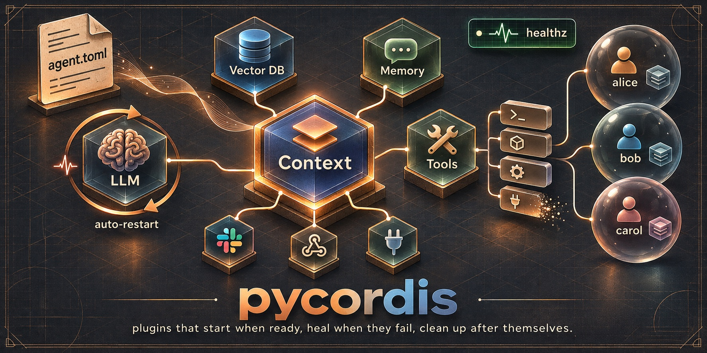

<p align="center">
  
</p>

<p align="center">
  <b>The plugin runtime for Python AI agents.</b><br>
  Models, tools, memory and connectors become plugins that start when they're ready,<br>
  restart when they fail, and clean up after themselves.
</p>

<p align="center">
  <a href="https://pypi.org/project/pycordis-framework/"></a>
  <a href="https://pypi.org/project/pycordis-framework/"></a>
  
  
  <a href="https://github.com/aswin-kevin/pycordis/actions/workflows/ci.yml"></a>
  <a href="https://github.com/aswin-kevin/pycordis/blob/main/LICENSE"></a>
</p>

```sh
pip install pycordis-framework
```

## The problem

Every real agent turns into this:

```
LLM client ─┬─ needs an API key, can be down at startup
            │
Vector DB ──┼─ needed by the "search_docs" tool
            │
Tools ──────┼─ some need the DB, some need a Slack token, some are optional
            │
Memory ─────┼─ per conversation, must never leak between users
            │
MCP servers, schedulers, webhooks, eval hooks ...
```

…held together by a 300-line `main()`, global clients, and the question
*"why didn't the search tool load?"*

## The fix: everything is a plugin

A plugin says what it **provides** and what it **needs**. pycordis does the rest.

```python
import asyncio
from collections.abc import Callable
from dataclasses import dataclass, field

from pycordis import Collection, Context, RestartPolicy, ServiceKey, current_context, plugin_meta


class Model:  # stand-in for your OpenAI / Anthropic / Ollama client
    async def reply(self, text: str, tools: list[str]) -> str:
        return f"{text!r} (tools: {', '.join(tools) or 'none'})"


@dataclass
class Memory:
    notes: list[str] = field(default_factory=list[str])


LLM = ServiceKey[Model]("llm")
TOOLS = ServiceKey[Collection[Callable[[str], str]]]("tools")
MEMORY = ServiceKey[Memory]("memory")


@plugin_meta(name="llm", provide=LLM, policy=RestartPolicy(mode="on-failure"))
async def llm(ctx: Context, config: None) -> None:
    ctx.provide(LLM, Model())  # if this raises, pycordis retries with backoff


@plugin_meta(name="search", inject=[TOOLS])
def search(ctx: Context, config: None) -> None:
    ctx.use(TOOLS).add(lambda q: f"results for {q}", name="web_search")


async def turn(text: str) -> str:
    chat = current_context()  # the conversation this turn runs in
    chat.use(MEMORY).notes.append(text)
    tools = [name for name, _ in chat.use(TOOLS).items()]
    return await chat.use(LLM).reply(text, tools)


async def main() -> None:
    async with Context() as app:
        await app.plugin(Collection.of(TOOLS))
        app.plugin(llm)
        search_tool = await app.plugin(search)

        async with app.scope(name="alice", inject=[LLM, TOOLS], provide=[MEMORY]) as chat:
            chat.provide(MEMORY, Memory())  # alice's memory, no one else's
            print(await chat.spawn(turn("hi")))
            await search_tool.dispose()  # unplug a tool at runtime
            print(await chat.spawn(turn("still there?")))
            print(chat.use(MEMORY).notes)


asyncio.run(main())
```

```text
'hi' (tools: web_search)
'still there?' (tools: none)
['hi', 'still there?']
```

The search tool vanished the moment its plugin unloaded. Nobody had to clean
anything up.

## What you get

| | |
| --- | --- |
| 🔌 **Dependency-aware startup** | A plugin runs only once what it injects exists. Order your code however you like. |
| ♻️ **Self-healing** | `RestartPolicy` retries failing plugins with backoff. Dependents wait instead of crashing. `load_timeout` stops a hung startup. |
| 🧰 **Tool registries** | `Collection[T]`: plugins add items, and an item disappears when its plugin unloads. |
| 💬 **Per-conversation scopes** | `ctx.scope(...)` gives each user their own services, torn down on exit, even after an error. |
| 🎯 **Typed end to end** | `ServiceKey[T]` makes `ctx.use(LLM)` a `Model`, and pyright checks it. Strict-typed, ships `py.typed`. |
| 🩺 **"Why isn't it running?"** | `ctx.diagnose()` and `pycordis doctor` name the missing service, the failed provider or the dependency cycle. |
| ⚙️ **Config files + hot reload** | TOML / JSON / YAML, `${env:KEY}` secrets, dev/prod profiles. Edit the file and only what changed reloads. |
| 📈 **Production-ready** | `/healthz`, `/readyz`, `/inspect` endpoints, lifecycle telemetry, JSON logs. |
| 🔒 **Zero dependencies** | Pure standard library. Nothing to audit, nothing to break in your supply chain. |

## Run it from a config file

```toml
# agent.toml
[loader]
watch = true                     # edit while it runs: only changed plugins reload

[[plugins]]
use = "my_agent.llm:llm"
config = { model = "claude-opus-5-5", api_key = "${env:ANTHROPIC_API_KEY}" }
restart = { mode = "on-failure", max_restarts = 5 }

[[plugins]]
use = "my_agent.tools:slack"
disabled = true                  # flip to false and it loads, live
```

```sh
pycordis start -c agent.toml --health-port 8080
```

When a plugin doesn't start, `pycordis doctor` tells you why:

```text
$ pycordis doctor -c app.toml
root #0 ACTIVE
└─ web-search #1 [entry search] PENDING
      missing-service: no plugin declares or currently provides "search_api"
```

## Coming from cordis?

pycordis is a faithful port of [cordis](https://github.com/cordiverse/cordis) 4.1.0
for asyncio: the same contexts, fibers, services, events and lifecycle, with
Python names. The [mapping table](https://github.com/aswin-kevin/pycordis/blob/main/docs/cordis-mapping.md)
lists every API side by side.

## Learn more

- 🤖 **[Build an agent](https://github.com/aswin-kevin/pycordis/blob/main/docs/guide-agents.md)**: an LLM agent end to end, with tools, scopes, supervision, health checks and diagnostics.
- 📖 **[Reference](https://github.com/aswin-kevin/pycordis/blob/main/docs/reference.md)**: every feature in depth.
- 🔁 **[cordis → pycordis](https://github.com/aswin-kevin/pycordis/blob/main/docs/cordis-mapping.md)**: the API mapping.
- 📝 **[Changelog](https://github.com/aswin-kevin/pycordis/blob/main/CHANGELOG.md)** · 🔐 **[Security](https://github.com/aswin-kevin/pycordis/blob/main/SECURITY.md)**

## License

MIT. pycordis is a port of [cordis](https://github.com/cordiverse/cordis)
(MIT, © 2021-present Shigma).
